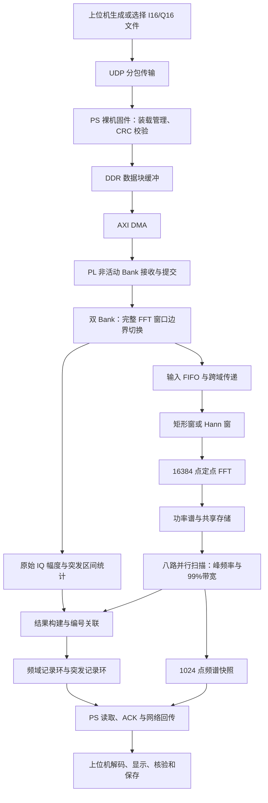

# FPGA 数字 IQ 信号分析仪——完整项目总结

整理日期：2026 年 10 月 21 日（Asia/Shanghai）。

项目基准：**Zybo Z7-20 / Zynq-7020，Phase13 Trial09，I16/Q16，160 MSPS 板内回放，16384 点 FFT**。

本文汇总赛题目标、系统架构、算法与接口、版本优化、仿真和实板结果、使用与复现方法、报告材料及 GitHub 归档情况。技术结论依据固定工程和已保存的原始记录；2026-10-21 的工作为资料核对与总结，没有重新下载 FPGA、运行真板测试或改动报告。文中的板卡运行结果均对应注明日期的历史验收，不代表对编写当日板端状态的实时确认。

## 目录

1. [项目概况与完成范围](#s1)
2. [赛题要求与最终指标](#s2)
3. [平台、环境和版本身份](#s3)
4. [整体架构与数据流程](#s4)
5. [核心算法与电路实现](#s5)
6. [结果记录、上位机与完整性检查](#s6)
7. [资源利用率与时序](#s7)
8. [版本演进与优化成果](#s8)
9. [仿真、实板、SD 和冷启动验证](#s9)
10. [已知边界与后续工作](#s10)
11. [工程目录与关键文件](#s11)
12. [运行、构建与复现方法](#s12)
13. [报告与截图材料](#s13)
14. [GitHub 管理、归档与恢复](#s14)
15. [证据索引与项目交接要点](#s15)

<a id="s1"></a>

## 1. 项目概况与完成范围

本项目面向“无线通信系统数字基带信号频谱分析电路设计”赛题，在 Zybo Z7-20 开发板上实现数字 IQ 信号的时域和频域分析。上位机生成或选择 IQ 数据，通过 UDP 发送至 Zynq 的 PS 侧 DDR；PS 利用 AXI DMA 将完整数据块送入 PL 非活动回放 Bank；PL 以固定速率回放样本，完成幅度、活动区间长度、峰频率和占用带宽测量；结果由 PS 经网络回传，上位机负责解码、显示和保存。

系统已经形成完整的“输入装载—板内处理—结果回传—参考比对—记录归档”链路。交付内容包括 RTL、固件、上位机、数据与参考生成程序、仿真平台、构建脚本、实板验证脚本、启动镜像、原始证据、实验报告及 GitHub 发布材料。

当前功能范围如下。

| 类别 | 已实现内容 |
| --- | --- |
| 输入与控制 | 小端 I16/Q16 文件装载、UDP 分包、CRC 校验、DDR 缓冲、DMA 搬运、双 Bank 更新 |
| 时域分析 | 原始 IQ 峰值、RMS、能量统计、数字零/门限突发检测、区间长度与完整性标志 |
| 频域分析 | 矩形窗/Hann 窗、16384 点 FFT、功率谱、峰频率、99% 占用带宽与带宽中心 |
| 运行模式 | 有限采集、持续回放、后台数据更新、窗口边界停止与排空 |
| 结果展示 | Python 命令行、Tkinter GUI、频谱快照、历史记录离线查看 |
| 验证与部署 | 位精确仿真、真板数值矩阵、宽带矩阵、动态切换、故障注入、连续运行、SD 自动启动和真实断电复验 |
| 版本归档 | Git 提交、工程固定标签、报告归档标签、Release 附件、散列清单和自动检查 |

输入来自**数字 IQ 测试向量回放**。当前尚未接入外部 ADC、射频接收链或实时模拟采集前端。项目所称“帧长度”是检测到的信号活动包络长度，不包含通信协议帧头、帧尾或字段解析。

<a id="s2"></a>

## 2. 赛题要求与最终指标

赛题同时要求完成 RTL 电路设计、前仿真、板级测试和性能优化。五项板级指标与当前结果的对应关系如下。

| 指标 | 赛题要求 | 当前已验证结果 | 统计口径 |
| --- | --- | --- | --- |
| 数字 IQ 位宽 | 不低于 12 bit | **I、Q 各 16 bit** | 一对复数样本共 32 bit |
| IQ 数据速率 | 不低于 100 MSPS | **160 MSPS** | FPGA 内部回放输入通路，每秒 1.6 亿对 IQ |
| FFT 点数 | 不低于 8192 点 | **16384 点** | 每窗 16384 对 IQ |
| 分析处理时间 | 不超过 2 ms | **最大 219.775 μs** | 板内窗口首样本时间戳至分析结果发布 |
| 数字 IQ 带宽 | 单位 MHz，未规定数值下限 | **158.154297～158.593750 MHz** | 272 项宽带矩阵中主组满带子集的 99% 占用带宽 |

结果进入可读取环形缓冲区的最大延迟为 **219.993750 μs**，与硬件分析延迟分别记录。上述两个延迟均不包括电脑上传、UDP 往返和 GUI 刷新时间。

前四项在项目采用的测量口径下达到数值门槛；第五项报告实际测得的带宽。赛题没有指定必须使用 99% 占用带宽算法，也没有给出相关容差，答辩时应主动说明定义。

### 2.1 常用派生数值

设复数采样率 `Fs = 160000000 Hz`，FFT 点数 `N = 16384`。

| 数值 | 计算方式 | 结果 |
| --- | --- | --- |
| 源时钟周期 | `1 / Fs` | 6.25 ns |
| 单个 FFT 窗口的采样跨度 | `N / Fs` | 102.4 μs |
| 单 Bank 回放跨度 | `32768 / Fs` | 204.8 μs |
| FFT 频率格宽 | `Fs / N` | 9765.625 Hz，即 9.765625 kHz |
| 不重叠窗口标称输入窗率 | `Fs / N` | 9765.625 窗/秒 |
| 复数基带频域范围 | `[-Fs/2, Fs/2)` | `[-80, +80) MHz` |
| 分析延迟对应周期数 | `219.775 μs × 160 MHz` | 35164 周期 |
| 结果入环延迟对应周期数 | `219.993750 μs × 160 MHz` | 35199 周期 |

最高离散频率格为 `+79.990234375 MHz`。频率格宽不是任意输入信号都能保证的测量误差，也不直接等于双音分辨能力。

### 2.2 数据更新速率与板内处理速率

持续提供 160 MSPS 的全新 I16/Q16 数据，仅有效载荷就需要：

```text
160000000 对/秒 × 4 字节/对 = 640 MB/s = 5.12 Gbit/s
```

本项目采用先装载、再高速回放的结构。新 Bank 未就绪时，当前 Bank 可以重复回放，因此 160 MSPS 不能解释为网口连续输入全新数据的速率。

2026-10-14 报告补测中，1000 次动态切换和 300 秒连续测试的有效平均上传速率分别为 **21.880890 Mbit/s**、**33.159468 Mbit/s**。计时包含 UDP 装载、DMA 提交和等待激活，不代表以太网物理链路带宽上限。其他日期的同类测试数值不同，应保留各自批次。

<a id="s3"></a>

## 3. 平台、环境和版本身份

### 3.1 硬件与软件环境

| 项目 | 已使用配置 |
| --- | --- |
| 开发板 | Digilent Zybo Z7-20 |
| FPGA 器件 | Zynq-7020，`xc7z020clg400-1` |
| PS | Cortex-A9，裸机固件与 lwIP 2.2.0 |
| FPGA 工具 | Vivado 2026.1，XSim 行为级仿真 |
| 软件构建与调试 | Vitis / XSDB / Bootgen 2026.1 |
| FFT IP | AMD/Xilinx FFT，`xfft 9.1` |
| 主机环境 | Windows、PowerShell、Python 3.12 |
| 精确参考依赖 | `numpy==2.5.3`；自动 GUI 截图使用 `Pillow==12.3.0` |
| 网络地址 | 板卡 `192.168.1.10`，UDP `5001`；主机有线网卡 `192.168.1.20/24` |
| 供电条件 | 已归档验收为用户确认的 USB 供电 |
| 启动方式 | SD 网络固件自动启动；JTAG 用于候选下载与调试 |

上述软件版本是已验收环境记录，依赖应以对应工程的 `requirements.txt` 为准。

### 3.2 固定工程身份

| 字段 | 值 |
| --- | --- |
| 最终实现 | Phase13 Trial09 |
| 硬件接口版本 | `0x0001000b`（65547） |
| 能力位 | `0x1f`（31） |
| 记录格式版本 | 1 |
| Build ID | `4757a33c02eed50a403db87d09cb091f` |
| 实现提交 | `806af4d4d50d696c358c5f22563000a9d56f899e` |
| 工程发布标签提交 | `cb04c3bb36940ad93665691d92cb46f533961107` |
| 原工程分支提交 | `0f224112cf0480e7e4eefcb2077350f2634b4135` |
| 报告及复现归档标签提交 | `4eeb6a5e090cd272a501e98da7fa7cf95791d951` |
| 归档分支提交，含下载说明和发布回执 | `65a3bf4f9d2f0c5c33c0d89aeba63f79fce9b3fb` |

实现提交、工程发布提交、发布回执提交和报告归档提交承担不同作用。后续报告归档没有改变 RTL、固件或上位机实现。

Build ID 用于核对构建输入身份，不等于完整 bitstream 或 BOOT 文件的 SHA-256。重新构建后即使 Build ID 相同，也应分别检查新产物散列及其验证记录。

### 3.3 两次网络启动镜像的区别

| 构建批次 | 网络 `BOOT_udp.BIN` 字节数 | SHA-256 |
| --- | ---: | --- |
| 原工程发布构建 | 4296596 | `6f83503bfb7b2b4097cbbf51886228521cbcd471dc23efce42a1c157aefc0050` |
| 2026-10-13 本机完整复现构建 | 4296660 | `83e0b3b408358cc4856eb9681552b5284ea21399d24d9c18648f80cec535546f` |

两份镜像各有独立的构建、安装和验收证据，不能使用原发布镜像的散列去核验本机复现镜像。复现构建的 SD 有限自测镜像为 4335140 字节，SHA-256 为 `4853e6a8081b7ba996e296f7c3470f2ac1a8df02bd7f10e9c0eab46b82d7fddd`。

`artifacts/BOOT.BIN` 在当前构建流程中是 SD 有限自测版，不能仅凭文件名将它当成网络镜像。网络部署应使用 `BOOT_udp.BIN`，或已验收 `ethernet_sd_card.zip` 中的 `BOOT.BIN`。

<a id="s4"></a>

## 4. 整体架构与数据流程



PS 承担网络协议、DDR 缓冲、搬运和运行管理；PL 承担按样本连续执行的运算；上位机承担输入准备、交互显示及独立参考验证。

PS 通过 GP0 访问自定义外设寄存器、记录和控制信息。DDR 数据由 AXI DMA 搬运至 PL，避免依靠处理器逐样本写寄存器来填充高速回放数据。

### 4.1 数据装载与双 Bank 切换

1. 上位机把输入拆成 UDP 数据包，携带块标识、偏移及校验信息。
2. PS 在 DDR 中接收完整数据块并维护 CRC、长度和装载状态。
3. DMA 向非活动 Bank 搬运；PL 核对接收长度、末尾和 CRC。
4. 校验与提交结束后更新 Bank 长度、block ID、CRC 和 ready 状态。
5. 当前完整 FFT 窗口结束后，才允许激活已准备好的新 Bank。
6. 装载错误、取消、不完整提交或写活动 Bank 不得形成正常提交。

双 Bank 保存输入 IQ，与频谱模块内部的共享功率谱是不同层次的存储结构，不能描述为“两份完整功率谱轮换”。

### 4.2 容量与格式

| 对象 | 配置 | 用途或换算 |
| --- | ---: | --- |
| 输入样本 | I16 + Q16 | 小端交错：`I0,Q0,I1,Q1,…`；每对 4 字节 |
| 每个回放 Bank | 32768 对 IQ | 128 KiB，可容纳两个 16K 窗口 |
| 两个 Bank 合计 | 65536 对 IQ | 256 KiB 有效样本存储 |
| 输入 FIFO | 4096 个样本 | BRAM 实现 |
| 频谱扫描并行度 | 8 路 | 每组处理 8 个连续频点 |
| 共享功率谱 | 一份完整 16384 点功率谱 | 另有双窗口元数据及延后写入队列 |
| 延后写入队列 | 5 banks，共 2560 条 | 保护上一窗口仍需读取的数据 |
| 频域记录环 | 128 条 × 128 字节 | 16 KiB 有效记录空间 |
| 突发记录环 | 128 条 × 64 字节 | 8 KiB 有效记录空间 |
| 快照 | 1024 点 | 每 16 个 FFT bin 取组内最大功率 |

单 Bank 装载常用 16384 或 32768 对 IQ。供完整核心回归使用的 65536 对长向量不能直接作为单个物理 Bank 装载。

<a id="s5"></a>

## 5. 核心算法与电路实现

### 5.1 时钟域、复位与元数据

最终源时钟、时间戳时钟和 FFT 时钟均为 160 MHz。PS FCLK1 保持 125 MHz，PL 使用 MMCM 产生相关时钟。标称频率相同不意味着可以删除跨域处理，现有设计仍保留输入/结果 FIFO、同步握手和复位传递。

有效样本携带窗口边界和关联信息进入处理链。结果构建时按窗口编号关联时域统计与频域结果，并检查不匹配情况。诊断计数通过各自时钟域快照取得，停止并排空后才进行完整计数守恒判断。

### 5.2 原始 IQ 幅度测量

对于 `x[n] = I[n] + jQ[n]`，原始时域功率为：

```text
p[n] = I[n]² + Q[n]²
E = Σ p[n]
A_peak = sqrt(max(p[n]))
A_RMS = sqrt(E / L)
```

固定 FFT 窗口的统计长度为 `L = 16384`；突发区间使用该区间实际长度。幅度统计使用**未加窗 IQ**，因此不会把 Hann 窗衰减误计为原始输入幅度变化。

高速通路逐样本计算平方和、能量累加及峰值，结果构建模块复用整数开方和除法单元，输出带 16 位小数的定点码值。变长区间均值保留整数商与余数，避免先整除再开方造成额外的小数损失。

幅度单位为数字码值，当前没有换算为经过模拟链路标定的电压、瓦数或 dBm。

### 5.3 活动区间与长度检测

系统支持两种检测方式。

| 模式 | 判断依据 | 关键语义 |
| --- | --- | --- |
| 数字零模式 | I/Q 是否为数字零及零间隙长度 | 短内部零间隙可并入同一突发，达到确认长度后结束 |
| 门限模式 | 滑动功率、启动/结束门限和连续确认长度 | 双门限降低抖动；候选结束与最终确认分离 |

门限模式在进入候选结束状态后暂存候选位置、尾段能量和峰值。若低能量连续达到要求，则以候选位置闭合区间，排除仅用于确认的尾段；若信号恢复，则将暂存统计并回活动区间。

区间采用左闭右开 `[start, end)`，长度为 `end - start`，对应时间为 `长度 / Fs`。`valid=0` 时不递增有效样本编号。停止截断、边界不完整、超长分段等情况使用标志保留其真实含义。

检测到的活动区间、单个 FFT 窗口、输入 Bank 长度和协议帧长度是不同对象，展示和统计时应分别解释。

### 5.4 窗函数、定点预处理与 FFT

频域分支支持矩形窗和 Hann 窗。Hann 系数采用四分之一周期存储，通过索引、对称及补值逻辑重构完整系数序列，并与参考实现进行等价性比较。

FFT 输入来自加窗和定点预处理后的样本。当前 FFT 内部数据为 24 bit，旋转因子为 18 bit，使用固定缩放及收敛舍入。外部输入仍为 I16/Q16，不能将内部位宽写成输入精度。

每 16384 个有效样本形成一窗，控制信号与数据经过相应流水延迟后对齐。工程中个别 IP 实例保留 `fft8192` 的历史名称，实际点数须依据配置、XCI 和硬件身份判断。

### 5.5 功率谱与频点

FFT 输出复数频域数据后计算功率：

```text
P[k] = Re(X[k])² + Im(X[k])²
```

当前功率数据为 48 bit，总功率和累计统计为 64 bit。频谱索引重排后按负频率到正频率进行扫描。对于重排索引 `q`：

```text
f(q) = (q - N/2) × Fs / N
```

峰频率取最高功率谱线对应的频率；宽带信号中，它不一定等于调制中心或载频。带宽中心由带宽上下边缘另行计算。

频率输出采用整数 Hz，并按实现约定舍入。160 MHz 常数乘法分解为 `78125 × 2^11`，通过寄存与恢复缩放缩短关键算术路径。

### 5.6 99% 占用带宽与八路扫描

设频谱总功率为 `S`，从负频率一端计算累计功率 `C(q)`。当前硬件阈值为：

```text
lower = ceil(S / 200)
upper = S - floor(S / 200)
q_low  = 首个满足 C(q) >= lower 的频点
q_high = 首个满足 C(q) >= upper 的频点
B_99   = (q_high - q_low) × Fs / N
f_center = ((q_low + q_high) / 2 - N/2) × Fs / N
```

带宽按边缘频点之差定义，没有额外增加一个 bin；各 Hz 字段按自己的整数换算结果输出，不能简单假定它们等于已舍入字段之间的任意组合。零功率、单 bin、边缘等情况保留相应标志。

16384 点功率谱分成 2048 组，每组 8 点。组内通过两项、四项、八项的平衡前缀流水形成累计值，组间反馈保留一级 64 bit 累加。阈值比较仍针对组内每个频点，扫描加速不会把边界定位粗化为 8 点一组。

### 5.7 共享功率谱与延后写入

系统使用一份完整功率谱存储。上一窗口正在扫描时，尚未读完的区域受到保护；下一窗口暂时不能覆盖的新功率进入延后写入队列，保护解除后排出回写。双窗口元数据另行保存总功率、峰值、编号和状态。

这种结构减少完整谱存储的重复开销，但依赖明确的扫描服务时间、队列容量和覆盖保护。修改 FFT 点数、扫描并行度或处理时钟时，必须重新检查最坏情况下的排队与数据覆盖关系。

### 5.8 DMA 提交与 Bank 元数据

`iq_dma_commit.sv` 将末字 CRC、合法性判断、Bank 路由和提交拆成四阶段事务；相对末尾直接提交增加 3 个时钟，期间 DMA 保持忙。

`iq_bank_metadata.sv` 统一维护长度、block ID、CRC 和 ready，减少多个条件竞争更新同一状态。取消或异常路径不发布正常 ready；正常数据块只允许一次成功提交。

### 5.9 回放 BRAM 按需使能

主机和回放端口仅在实际访问时使能，返回数据与延迟后的 Bank 选择对齐。最终布局布线网表确认，两个回放 Bank 共 64 个 RAMB36，其 128 个 A/B 端口使能均为动态逻辑，常高使能端口为 0。

这一结论证明结构优化已落实到物理资源，但项目尚未通过受控电功率实验给出总功耗下降百分比。

<a id="s6"></a>

## 6. 结果记录、上位机与完整性检查

### 6.1 两类结果记录

频域记录为 1024 bit，突发记录为 512 bit，分别进入 128 条容量的环形缓冲区。记录包含测量结果、epoch、编号、配置身份及完整性标志。

记录按 32 bit 分次写入，只有整条写入完成才推进生产者计数，避免软件看到半条记录。PS 读取后通过 ACK 推进消费者，释放空间。

ACK 分为校验和执行两步；合法性在校验时固定，执行时原子更新消费者及下一页信息。非法 ACK 不推进消费者，零字节选通与不完整选通按接口约定处理，32 位计数回绕通过专门测试检查。该调整使 ACK 响应增加一个 160 MHz 时钟，即 6.25 ns，没有给采样或 FFT 主通路新增一级延迟。

### 6.2 上位机职责

上位机负责选择输入、设定窗和检测器、发送配置、开始/停止采集、读取频域/突发记录及快照，显示幅度、长度、频率、带宽、延迟和错误信息，并保存 `META.JSON`、采集记录及相应数据文件。

频谱快照为 1024 点，每 16 个 FFT bin 取最大功率，用于可视化；它不是完整 16384 点频谱，不能用屏幕曲线反算代替硬件完整频谱的带宽结果。GUI 的输入包络可以来自上传文件，是输入参考，不等于新增的硬件逐样本回读通道。

### 6.3 数据与编号必须对应

界面顶部数值、频域记录和频谱快照应通过窗口编号确认关联。仅仅把截图上的窗口文字改成相同编号，不能建立数据对应关系。

最终报告图 4-7、图 4-9使用的是已经核对过的窗口 0 数值及窗口 0 快照；对应原始记录和散列保存在 `report8_edit_20261014/screenshot_evidence.json`。其中突发长度仍来自独立突发记录，不应解读成该 FFT 窗口的长度。截图修正不等于生产 GUI 的自动关联逻辑已完成新改版，后者仍是后续改进项。

### 6.4 完整性检查

系统结合包/块 CRC、DMA 长度与末尾检查、记录序号、窗口/配置编号、FIFO/队列拒绝计数、UDP 缺包及硬件错误状态判断链路完整性。

停止并排空后，应核对：

```text
issued_samples = accepted_samples
               = fft_input_samples
               = fft_output_samples
               = completed_windows × 16384
```

运行中不同域的快照取得时间不同，不能把瞬时计数差直接认定为丢样。正常采集的零错误与故障注入时的预期拒绝也应分开统计。

<a id="s7"></a>

## 7. 资源利用率与时序

### 7.1 最终实现资源

| 资源 | 已用 / 可用 | 利用率 |
| --- | --- | ---: |
| Slice LUT | 22708 / 53200 | 42.68% |
| Slice Registers | 28413 / 106400 | 26.70% |
| LUT as Memory | 5740 / 17400 | 32.99% |
| Block RAM Tile | 128 / 140 | 91.43% |
| DSP48E1 | 49 / 220 | 22.27% |
| Slice | 8390 / 13300 | 63.08% |
| BUFG | 4 / 32 | 12.50% |
| MMCM | 1 / 4 | 25.00% |

BRAM 由 103 个 RAMB36 和 50 个 RAMB18 组成，等效 `103 + 50/2 = 128` 个 Tile。LUT as Memory 是 Slice LUT 的子项，不能再与总 LUT 相加。

BRAM 的主要分配为：

```text
64 回放 Bank + 27 FFT + 24 频谱存储 + 4 输入 FIFO
+ 4 频域记录环 + 2 突发记录环 + 2 快照 + 1 AXI DMA = 128
```

DSP 的主要分配为：

```text
36 FFT + 2 窗乘法 + 4 频谱 + 2 时域 + 5 结果换算 = 49
```

当前容量最紧张的资源是 BRAM，仅余 12 个 Tile。继续增大 FFT、缓存或并行通路前，必须重新核算存储。

### 7.2 时序结果与余量

| 项目 | 最终结果 |
| --- | --- |
| 建立时间最差余量 | **+0.007 ns** |
| 保持时间最差余量 | **+0.050 ns** |
| 关键 CDC 问题 | 0 |
| 未约束内部端点 | 0 |
| 最终静态时序门禁 | 通过 |

报告补测所用时序文件中，最差建立路径位于频谱累计分位边界逻辑，从 `cdf_bin_reg[5][3]` 到 `highq_reg[0]` 使能端，数据路径延迟为 5.827 ns。

7 ps 的建立余量很小，当前通过只对应固定构建。更改 RTL、约束、工具版本或布局后，不能直接沿用该结论。关键 CDC 为 0 也不表示全部工具 Warning 为 0，已有 CDC、DRC 和方法学告警应随报告保留。

<a id="s8"></a>

## 8. 版本演进与优化成果

### 8.1 主要演进

| 阶段 | 主要变化 | 源 / FFT 时钟 | FFT 点数 | 最大分析 / 入环延迟 |
| --- | --- | --- | ---: | --- |
| Phase8 r17 | DDR/DMA 输入、双 Bank 持续更新基线 | 125 MHz 级前期版本 | 8192 | 不与 16K 版本混用 |
| Phase9 | 8K 扩展到 16K | 125 / 125 MHz | 16384 | 281.296 / 281.576 μs |
| Phase10 修复版 | 共享功率谱、Hann 存储优化，输入 FIFO 保留 BRAM | 125 / 125 MHz | 16384 | 281.296 / 281.576 μs |
| Phase11 | FFT 提至 150 MHz，调整运算与控制流水 | 125 / 150 MHz | 16384 | 278.448 / 278.728 μs |
| Phase12 | 源与时间戳提高至 150 MHz，扩展宽带验收 | 150 / 150 MHz | 16384 | 234.426667 / 234.660000 μs |
| **Phase13 Trial09** | 控制路径、提交、ACK、BRAM 使能优化 | **160 / 160 MHz** | **16384** | **219.775 / 219.993750 μs** |

相比 Phase12，Phase13 板内速率提高约 6.67%，最大分析延迟降低 6.25%；主组满带子集的带宽由约 148 MHz 扩展至约 158 MHz。BRAM 和 DSP 保持 128 / 49，LUT 由 22765 降至 22708，FF 由 28377 增至 28413。

这些收益主要来自让现有 16K 结构在 160 MHz 下完成时序和实板验收，不应表述为 Phase13 大幅减少了 BRAM。FFT 点数不变而 Fs 增大，也使频率格宽从 9.1552734375 kHz 增至 9.765625 kHz。

### 8.2 主要技术特点

1. 八路平衡前缀扫描，保持单频点带宽边界定位。
2. 输入双 Bank 与单份完整功率谱共享，分别处理数据更新和频谱存储开销。
3. 候选结束位置与确认尾段分离，保持有效区间语义。
4. 高速样本统计与低频结果开方/除法复用，减少重复算术单元。
5. Hann 系数重构与 BRAM 原生端口按需使能。
6. DMA 分阶段提交、Bank 元数据统一维护、ACK 校验与执行分离。
7. 以定点参考、窗口编号、计数守恒和散列绑定建立可追溯验证链。

### 8.3 候选失败记录的意义

Phase13 曾经历多个时序未通过或完整回归未结束的候选。Trial05 虽通过数值和宽带测试，却在 DMA 连续测试中两次出现意外 POR，不能视为完整验收通过。Trial09 才完成最终仿真、时序、RAM、SD、真实断电和发布验证。

原候选日志保留在 `reports/phase13_trial*`。引用结果时必须确认候选、Build ID 和验证阶段，不能把失败候选的某项 PASS 拼入最终版本成果。

<a id="s9"></a>

## 9. 仿真、实板、SD 和冷启动验证

### 9.1 验证批次

| 时间 | 工作 | 与其他批次的关系 |
| --- | --- | --- |
| 2026-10-12～13 | 原工程 Trial09 验收、SD 安装、真实断电和原始发布 | 原工程固定标签的证据 |
| 2026-10-13 下午 | 本机独立重新构建及完整复现 | 源实现不变，生成新产物和独立验收记录 |
| 2026-10-14 | 报告仿真截图、实板补测、同窗口截图修正 | 报告中的新增展示与测量材料 |
| 2026-10-19 | 最终报告及后续复现材料 GitHub 归档 | 上传、回下载、散列与恢复验证；没有新做真板测试 |
| 2026-10-21 | 项目总结与远程状态核对 | 本文编写，没有新增硬件验收 |

### 9.2 完整核心仿真

完整核心使用 160 MHz 源时钟和 FFT 时钟，覆盖零输入、正负复单音、突发单音、QPSK、跨窗口短突发、负满幅直流等输入，两种窗函数合计 16 组。每组 65536 对 IQ，对应四个 16384 点窗口。

- 共逐点比对 **1,048,576 个复数 FFT 输出**。
- 共输出 **64 条频域记录、14 条突发记录**。
- 参考为 AMD FFT bit-accurate C model 以及独立整数时域/突发参考。
- 归档结果通过，最大分析延迟为 219.775 μs。

此外，组件回归覆盖数学范围、Hann 重构、时间测量等价性、数字突发、带宽边缘、共享谱保护、DMA 提交/取消、AXI 控制、ACK 回绕与 Bank 切换。

2026-10-14 为截图冻结的核心 WDB 仅承诺所列代表性信号与时间段可读，不能将这次部分运行当成重新完成了全部核心回归。完整核心结果来自 2026-10-13 归档。截图中的单元测试按各自时钟解释：核心/AXI/提交为 160 MHz，部分频谱/共享/Hann 为 125 MHz，部分数学/数字突发测试为 100 MHz，时间等价性平台约 150 MHz。

### 9.3 79 项真板数值矩阵

矩阵包括幅度、边界、间隔、单音、调制、噪声、双音和宽带类别。每轮形成 158 条频域记录、88 条突发记录，并核对 80896 个快照值。

RAM、SD 系统复位、物理冷启动以及 2026-10-14 报告补测分别有独立记录。测试通过说明硬件输出与指定算法参考一致，不意味着所有压力输入都具有理想的检测准确率。

以 2026-10-14 数值记录为例，相对于同一份量化 I16/Q16 输入的数学参考，最大峰值误差约 `1.503350359×10^-5 code`，最大 RMS 误差约 `1.516419798×10^-5 code`，均小于一个 Q16 小数最低位。若改为量化前理想波形参考，误差数值会不同，不能省略参考定义。

### 9.4 272 项宽带矩阵

| 项目 | 结果 |
| --- | --- |
| 分组 | primary 200、shift 48、amplitude 24 |
| 窗函数 | 矩形窗 136、Hann 窗 136 |
| 频域记录 | 544 条 |
| 快照核对 | 278528 个值 |
| 全矩阵带宽范围 | 25.224609～158.593750 MHz |
| 主组满带子集 | 158.154297～158.593750 MHz |
| 与独立参考的上下边缘整数 bin 偏差 | 0 格 |
| 带宽整数 Hz 输出与独立参考的最大差 | 0.5 Hz，来自舍入 |
| 独立准确度失败项 | 0 |

全矩阵包含故意生成的窄带用例，不是 272 项全部达到 158 MHz。0.5 Hz 是当前离散定义与数值参考之间的差值，不能表述为系统具有 0.5 Hz 连续频率分辨率。

### 9.5 2026-10-14 报告补测结果

| 项目 | 1000 次 DMA 切换 | 300 秒连续运行 |
| --- | ---: | ---: |
| 验证结果 | PASS | PASS |
| Bank 切换次数 | 1000 | 9487 |
| 实际连续测试时长 | 按 1000 次切换测试记录 | 300.000 s |
| 频域记录 / 完成窗口 | 486283 | 2929822 |
| 突发记录 | 7599 | 45779 |
| 发出、接受、FFT 输入及输出样本 | 各 7967260672 | 各 48002203648 |
| 输入 FIFO 观察高水位 | 12 | 12 |
| 频域序号缺口 / UDP 缺包 | 0 / 0 | 0 / 0 |
| 输入拒绝 / 结果队列拒绝 / 空读 | 0 / 0 / 0 | 0 / 0 / 0 |
| 最大分析延迟 | 219.775 μs | 219.775 μs |
| 最大结果入环延迟 | 219.993750 μs | 219.993750 μs |
| 有效平均上传速率 | 21.880890 Mbit/s | 33.159468 Mbit/s |

连续运行组测得带宽为 158.095703～158.554688 MHz。1000 次测试另外包含包 CRC 损坏、乱序 offset、不完整提交、写活动 Bank 四类故障注入，均按预期拒绝。

上述数据来自报告补测，不能与原工程 2026-10-12/13 的窗口数或切换数互换。边界停止和排空可能使最终计数略超过以请求时长直接相乘得到的值，应以记录的有效样本和完整窗口为准。

### 9.6 本机复现与真实冷启动

2026-10-13 本机复现从固定源提交重新生成 XSA、bitstream、FSBL、网络/SD 固件及 BOOT，未修改 RTL、固件和上位机实现。完整仿真、79 项数值、272 项宽带、DMA1000、60/300 秒连续、GUI、SD 安装及读回均通过。

冷启动初检读到断电前的 `epoch=79`，该次未被接受为冷启动证明。用户再次确认电源灯熄灭至少 5 秒并重新上电后，记录以 `epoch=0` 开始，只通过网络核对身份并执行 79 项数值和 **300.016 秒**连续测试，最终通过。该过程没有在用户断电确认后重新下载程序来代替 SD 自动启动。

物理断电由用户操作并确认，软件没有直接测量断电波形。系统复位、JTAG 下载与真实拔电分别记录，不能互相替代。

<a id="s10"></a>

## 10. 已知边界与后续工作

### 10.1 已知边界

| 边界 | 已有证据与正确解释 |
| --- | --- |
| 外部输入能力 | 尚无 ADC/射频前端；160 MSPS 为板内回放处理速率 |
| 低信噪比检测 | 0 dB 固定种子组的 6 个真值突发全部漏检；10/20 dB 对照组各 6 个检出且无误报，仅限对应配置 |
| Hann 窗边缘突发 | 40 MHz 真值可出现 39.873047 MHz 的峰频输出，偏差约 −126.953 kHz |
| 数字零间隙 | `gap_min=32` 时，31 点零间隔按规则合并，不能宣称所有帧长都零误差 |
| 低幅与定点缩放 | 输入非零不保证经过窗和定点 FFT 后具有可用峰值 |
| 帧语义 | 当前测量活动包络，不识别协议帧；超长、停止和边界区间可能分段或截断 |
| 存储余量 | BRAM 91.43%，扩展点数和缓存受约束 |
| 时序余量 | 建立余量 7 ps，需要先改善裕量再评估继续提频 |
| 功耗与意外 POR | Trial09 在已测范围未复现 Trial05 的 POR；电气根因未确定，也无可靠总功耗下降百分比 |
| 稳定性范围 | 结论对应指定板卡、USB 条件和有限测试时长，不能扩展为任意供电及无限运行时间保证 |
| 界面关联 | 报告修正截图已核对同窗口，生产 GUI 的自动关联展示仍可进一步完善 |

板载监测约 0.2 秒级的采样间隔及平均处理不能排除更短的供电扰动，因此不能仅凭监测数据证明或排除 USB 瞬态压降。

### 10.2 后续工作顺序

1. 优先优化频谱累计阈值比较、边界选择和使能路径，增加 160 MHz 下的时序余量。
2. 分别测量主机发送、DDR 收齐、缓存维护、DMA、Bank 激活和结果回传时间，再针对实际瓶颈提高有效数据更新率。
3. 针对低信噪比与边界偏差评估噪声底估计、门限调整和谱峰插值；需要协议帧识别时再加入前导相关等机制。
4. 让 GUI 数值、快照和窗口编号可靠关联，并明确完整突发、截断区间和 FFT 窗口的区别。
5. 扩展外部采集、FFT 点数、平均或并行通路前，先核算 BRAM、带宽、队列和服务周期。
6. 新候选依次完成单元验证、完整核心仿真、布局布线、RAM 验收、SD 复验和真实冷启动，保留旧稳定版本用于回退。

这些是后续方向，不计入当前已完成功能。

<a id="s11"></a>

## 11. 工程目录与关键文件

### 11.1 本机目录

| 路径 | 含义 |
| --- | --- |
| `D:\fft\fft_phase13_structure_opt` | 原始已验收工程工作树 |
| `D:\fft\fft_phase13_reproduction_20261013` | 本机重新构建与完整复现目录 |
| `D:\fft\phase13_github_archive_20261019` | 最终报告及复现材料 GitHub 归档工作树 |
| `D:\fft\报告.docx`、`D:\fft\报告.pdf` | 用户确认用于归档的最终报告 |
| `D:\fft\报告三图片` | 第三章截图、图表、索引及仿真证据 |
| `D:\fft\报告四图片` | 第四章截图、索引及证据来源 |
| `D:\fft\report3_capture_20261014` | 仿真截图工作区、WDB/VCD、脚本和事件数据 |
| `D:\fft\report4_capture_20261014` | 实板补测、有限采集、DMA1000 和 continuous300 |
| `D:\fft\report8_edit_20261014` | 同窗口修正截图与关联证据 |
| `D:\fft\phase13_archive_assets_20261019` | 原始逻辑归档包及清单 |
| `D:\fft\phase13_archive_parts_20261019` | 大包分卷、恢复脚本和分卷校验清单 |
| `D:\fft\phase13_archive_download_verify_20261019` | GitHub 回下载校验副本与合并还原包 |

多个历史工程工作树共享 `D:\fft\fft_phase7_release_git\.git`。目录名较早不代表可直接删除；单独复制某个工作树的 `.git` 文件也不等于复制完整 Git 历史。

### 11.2 工程内部结构

```text
config/       构建速率、FFT 点数、容量和存储结构配置
rtl/          FPGA 运算、接口、回放、记录与跨域逻辑
firmware/     网络固件、SD 自测固件
host/         UDP 客户端、GUI、连续更新和记录解析
tests/        输入生成、独立参考、RTL testbench、协议测试
scripts/      构建、板测、离线核验、SD 安装与发布打包
constraints/  时序和物理约束
data/         IQ、ROM 系数和参考相关数据
vendor/       板卡预设、第三方组件及许可证
docs/         操作、接口与发布说明
reports/      构建证明、数值和板测证据、历史失败候选
build/        本机构建工程、仿真输出和临时产物
artifacts/    bit、XSA、ELF、FSBL、BOOT
reproduction/ 本机复现的汇总、执行记录与异常尝试
release/      分发包；最终验收包位于 phase13_sd_verified/
```

### 11.3 关键模块

| 文件 | 主要职责 |
| --- | --- |
| `config/build_profile.json` | 当前 160 MHz、16K FFT 和容量配置 |
| `rtl/iq_build_config.sv` | 生成的硬件配置与 Build ID |
| `rtl/iq_peripheral.sv` | AXI 寄存器、回放控制、Bank 所有权与 ACK |
| `rtl/iq_dma_commit.sv` | DMA 末尾校验、取消与原子提交 |
| `rtl/iq_bank_metadata.sv` | Bank 元数据统一更新 |
| `rtl/iq_replay_bank.sv` | 同步 RAM、数据返回对齐和端口使能 |
| `rtl/analyzer_core.sv` | 运算链连接、FIFO、跨域及窗口关联 |
| `rtl/window_fft.sv` | 窗处理及 FFT 接口 |
| `rtl/spectrum_measure.sv`、`spectrum_lane.sv`、`spectrum_store.sv` | 功率谱、八路扫描、共享存储、带宽与快照 |
| `rtl/time_measure.sv`、`digital_burst_measure.sv` | 幅度和活动区间测量 |
| `rtl/result_builder.sv` | 开方/除法复用、频率换算、记录封装 |
| `rtl/record_ring.sv` | 生产/消费计数、容量、ACK 和回绕 |
| `firmware/echo.c` | 当前 UDP 网络固件 |
| `firmware/sd_main.c` | SD 有限自测固件 |
| `host/iq_client.py` | 网络协议、身份检查、采集与解码 |
| `host/monitor.py`、`monitor_view.py` | GUI 和数据展示 |
| `host/streaming.py` | 连续更新非活动 Bank |
| `scripts/run.ps1` | 构建与普通打包入口 |

分析器 AXI 基址为 `0x40000000`，AXI DMA 控制基址为 `0x40400000`。版本、Build ID、错误、epoch、诊断快照、Bank 和 DMA 状态均可由现有客户端读取，普通操作不需要直接写未知寄存器位。

<a id="s12"></a>

## 12. 运行、构建与复现方法

以下命令是后续操作示例，未在本次总结过程中执行。重新测试应写入新输出目录，保留已验收证据。

### 12.1 日常使用

1. 保持已验收 SD 卡及启动跳线，连接供电和网线。
2. 确认主机有线网卡为 `192.168.1.20/24`，板端网络固件为 `192.168.1.10:5001`。
3. 同一时刻只使用一个控制客户端，避免 GUI、命令行和验收脚本互相争用。
4. 双击复现目录中的 `Open_Reproduced_IQ_Monitor.cmd`，或运行：

```powershell
Set-Location -LiteralPath 'D:\fft\fft_phase13_reproduction_20261013'
$env:PYTHONUTF8 = '1'
$env:IQ_CLIENT_SOURCE_IP = '192.168.1.20'
python host/monitor.py
```

SD 自动启动的是固件服务，采集任务仍需上位机配置与发起。正常使用已部署的 SD 镜像不需要每次重新用 Vivado 下载。

### 12.2 有限采集示例

```powershell
python host/iq_client.py capture --board 192.168.1.10 --source-ip 192.168.1.20 --vector data/replay_vectors/burst_fs4.bin --window hann --detector digital-zero --out captures/phase13_summary_example_01
```

应优先从当前控制程序停止采集并等待排空。固件运行期间可能锁定原 UDP peer，另开一个程序的源端口不同，不能将新进程的 stop 命令当成无条件有效的抢占接口。

### 12.3 先做离线证据核验

在具有匹配完整证据的工程副本中：

```powershell
python scripts/verify_phase13_evidence.py
python scripts/verify_phase13_cold_boot.py
```

预期标志分别为 `PHASE13_EVIDENCE_PASS` 和 `PHASE13_SD_COLD_BOOT_EVIDENCE_PASS`。它们检查归档散列与关联，不会重新综合 FPGA 或重新测量板卡。轻量源码 ZIP 不包含全部 reports，应与匹配证据包配合使用。

### 12.4 从固定源版本重新构建

```powershell
git clone --branch v2026.10.13-phase13-structure160-usb-sd-validated https://github.com/vermouth2031/fft.git D:\fft\fft_phase13_rebuild_new
Set-Location -LiteralPath 'D:\fft\fft_phase13_rebuild_new'
git switch -c work/phase13-rebuild-new
$env:PYTHONUTF8 = '1'
python -m pip install -r requirements.txt
Remove-Item Env:IQ_CLIENT_SOURCE_IP -ErrorAction SilentlyContinue
.\scripts\run.ps1 -Action All
```

这里清除网卡源地址环境变量是为避免离线 UDP 单元测试继承真板网卡地址；开展实际板测时再按需设置。工具默认路径为 `D:\VivadoMM\2026.1\Vivado`、`D:\VivadoMM\2026.1\Vitis`，可通过 `-VivadoRoot`、`-VitisRoot`、`-Python` 指定。

构建阶段支持 `Reference`、`Sim`、`Hardware`、`RebuildHardware`、`Software`、`Package`、`All`。FFT 工程通常位于 `build/vivado16k/iq_analyzer.xpr`，板级工程位于 `build/board/iq_board.xpr`。

`All` 完成构建和普通打包，不自动证明真板通过，也不自动完成真实断电验收。软件构建含已验证的 timer/PHY 修正，更换模板或工具后应重新完成相关检查。

### 12.5 新版本验收顺序

```text
新工作目录和构建身份
  → 参考生成及完整 RTL 回归
  → 最终布局布线、CDC、资源核验
  → XSA、ELF、FSBL、BOOT 绑定检查
  → RAM/JTAG 数值、宽带、DMA、连续运行验收
  → 备份 SD 旧 BOOT，安装网络镜像并完整读回
  → SD 模式系统复位复验
  → 用户真实断电，网络独立确认身份与功能
  → 冷启动证据打包、固定标签和发布核验
```

主要板测入口为 `phase13_board_validation.py`、`phase13_wideband_campaign.py`、`phase13_dma_validation.py` 和 `phase13_wideband_stability.py`。它们需要匹配的新构建产物与参考索引，不能直接对任意运行版本套用旧参考。

### 12.6 SD 镜像管理

网络使用应选择匹配版本的 `BOOT_udp.BIN`，以 `BOOT.BIN` 文件名部署到 SD 根目录，并核对 SD 上的完整文件散列。本机复现安装时，旧镜像备份名为 `B319177A.BIN`；原发布安装的备份名为 `B1CF665D.BIN`，两者属于不同事务。

发生 SD 维护超时时，应先确认维护任务是否仍在写卡，再决定复位或断电。正常恢复不需要为了替换一个 BOOT 文件而格式化整张卡。物理冷启动验证期间不得通过 JTAG 下载或系统复位代替上电结果。

<a id="s13"></a>

## 13. 报告与截图材料

### 13.1 最终报告组织

| 报告部分 | 对应项目内容 |
| --- | --- |
| 第一部分：调研与方案选择 | 赛题约束、平台选择、FFT 与 PS/PL 分工 |
| 第二部分：系统设计方案 | 架构、装载、双 Bank、跨域、窗与 FFT、功率谱、带宽、幅度、长度、结果记录 |
| 第三部分：功能仿真结果 | 核心与单元仿真、边界和错误处理、参考比较及实际波形 |
| 第四部分：实板测试结果 | 平台、资源、时序、测量、动态切换、连续运行与冷启动 |
| 第五部分：创新点 | 八路扫描、共享存储、区间确认、数学复用、系数重构与按需访问 |
| 第六部分：总结与展望 | 已完成结果、适用边界和未完成的优化方向 |

2026-10-19 用户明确确认 `D:\fft\报告.docx` 和 `D:\fft\报告.pdf` 为归档的最终报告。归档时逐字节复制，没有重新排版或重新导出 PDF。

| 文件 | 归档 SHA-256 |
| --- | --- |
| `报告.docx` | `f171b4c8e59c893416f14a27e77667b74be88ee48f784f054baba62fd5aab737` |
| `报告.pdf` | `3533c1de168ab35b07040b1dab3ee31402f7d55596d759e65d56641349721d34` |

### 13.2 截图使用规则

- `报告三图片`、`报告四图片` 保留最初的文件名与索引，文件名编号不一定等于最终 Word 的题注编号。
- 原始截图与修正截图同时保留用于追溯，引用最终图 4-7、图 4-9时应采用 `figure4_7.png`、`figure4_9.png` 及其同窗口证据。
- 修正后的图 4-7：窗口 0，RMS 5811.717 code，峰频率 −75.537109 MHz，99% 带宽 158.515625 MHz。
- 修正后的图 4-9：窗口 0，RMS 6333.691 code，峰频率 −19.531250 MHz，99% 带宽 145.595703 MHz。
- 单音图中的 32768 对 IQ、204.8 μs 应按有限回放区间及停止截断状态解释；单个 16384 点 FFT 窗口为 102.4 μs。
- 前端“离线查看”截图可以来自真实板卡已经采集的记录，但它不是截图当时又执行了一次实时板测的证明。

<a id="s14"></a>

## 14. GitHub 管理、归档与恢复

### 14.1 已核对的远程入口

2026-10-21 已读取 GitHub 远程状态：原工程分支为 `0f224112`，归档分支为 `65a3bf4f`；报告归档 Release 已公开，标记为 prerelease，包含 100 个附件；PR #8 仍为 OPEN / Draft，未合并。

| 用途 | 入口 |
| --- | --- |
| 项目仓库 | [vermouth2031/fft](https://github.com/vermouth2031/fft) |
| 原工程分支 | [phase13/structure-160m](https://github.com/vermouth2031/fft/tree/phase13/structure-160m) |
| 原工程固定发布 | [v2026.10.13-phase13-structure160-usb-sd-validated](https://github.com/vermouth2031/fft/releases/tag/v2026.10.13-phase13-structure160-usb-sd-validated) |
| 最终报告及复现归档 | [v2026.10.19-phase13-report-reproduction](https://github.com/vermouth2031/fft/releases/tag/v2026.10.19-phase13-report-reproduction) |
| 归档目录与说明 | [archives/phase13-report-reproduction-20261019](https://github.com/vermouth2031/fft/tree/archive/phase13-report-reproduction-20261019/archives/phase13-report-reproduction-20261019) |
| 原工程审查入口 | [PR #8](https://github.com/vermouth2031/fft/pull/8) |

本轮归档使用独立分支 `archive/phase13-report-reproduction-20261019`，没有把工程合并到 `main`。获取当前版本应使用明确分支或标签，不应只依据默认分支首页的旧版信息。

### 14.2 两种发布的内容

原工程发布包含 7 个附件：网络 SD 启动包、源码包、manifest、RAM 验收 JSON、冷启动验收 JSON、完整冷启动证据包及 SHA256SUMS。

2026-10-19 归档补齐最终报告、仿真及实板截图、同窗口修正材料、复现 reports 快照、操作日志和已验收复现分发包。逻辑上的主要文件为：

| 文件 | 内容 |
| --- | --- |
| `final_report.docx` | 最终 Word 原文件 |
| `final_report.pdf` | 最终 PDF 原文件 |
| `phase13_board_capture.zip` | 报告实板采集、图片及同窗口修正证据 |
| `phase13_reproduction_snapshot.zip` | reports 快照、复现记录、失败尝试、最终验收和封装分发包 |
| `phase13_simulation_capture.zip` | 仿真截图、原始波形、配置、日志、脚本和证据索引 |
| `file-manifest.json` | 逐文件来源、大小和 SHA-256 |
| `SHA256SUMS.txt` | 原始逻辑附件的散列 |

两个大 ZIP 采用 8 MiB 原始字节分卷：复现包 32 卷，仿真包 59 卷；加上两份报告、实板包、清单及恢复材料，共 100 个 Release 附件，总计约 786 MB。

原有重复解压副本、仿真缓存和部分旧报告副本未重复纳入，具体范围见 manifest 的排除记录。reports 快照包含历史阶段证据，不应把其中每一个文件都理解为本次新增测量。

### 14.3 下载与恢复

```powershell
gh release download v2026.10.19-phase13-report-reproduction --repo vermouth2031/fft --dir phase13_archive
Set-Location -LiteralPath '.\phase13_archive'
python restore_archives.py
```

恢复脚本使用 Python 标准库，先检查每卷大小和 SHA-256，再按顺序合并并校验完整 ZIP，保留分卷文件。`.partNNN` 不能单独解压；所有分卷、`split-manifest.json` 和脚本应位于同一目录。

下载说明为 `DOWNLOAD_README.txt`，分卷校验表为 `SPLIT_SHA256SUMS.txt`。仓库中大型逐文件清单使用无损 `file-manifest.json.gz`，解压后与 Release 中的 JSON 相同。

恢复工程时，应在独立副本中使用复现快照，整体恢复其 reports，避免原版本已删除的文件残留。快照里的 `launchers/Open_Reproduced_IQ_Monitor.cmd` 对应原工程根目录启动脚本；迁移机器时需要核对绝对路径。原工程源码、原发布镜像和本机复现镜像应按各自身份与散列使用。

### 14.4 已完成的归档验证

- 本地 40318 个归档文件通过核验，其中 ZIP 内成员 40254 个。
- 最终 Word/PDF 与用户确认的原文件逐字节一致。
- 100 个 Release 附件逐一重新下载并通过 SHA-256 校验。
- 两个大 ZIP 已从下载分卷实际还原，并与本机原 ZIP 散列一致。
- 原归档提交的分支与标签自动检查通过；补充发布回执的提交检查也通过。

GitHub Actions 执行 Python、协议和离线证据检查，不包含新的 Vivado 综合或真板测量。发布回执保存在归档目录的 `publication-receipt.json`，本机亦保存 `phase13_archive_publication_20261019.json`。

<a id="s15"></a>

## 15. 证据索引与项目交接要点

### 15.1 本文主要依据

以下本地链接按本文位于 `D:\fft` 组织。

| 资料 | 用途 |
| --- | --- |
| [赛道2赛题整理](赛道2_FPGA设计及应用赛题整理.md) | 任务、五项指标与评分要求 |
| [Phase13 完整交接文档](Phase13项目完整交接文档_20261013.md) | 原工程架构、算法、历史验收与部署说明 |
| [原工程版本](fft_phase13_structure_opt/VERSION.json) | 实现提交、Build ID、原发布镜像身份 |
| [当前构建配置](fft_phase13_reproduction_20261013/config/build_profile.json) | 速率、FFT 点数、容量与存储结构 |
| [本机复现汇总](fft_phase13_reproduction_20261013/reproduction/result.json) | 新构建、新验收、USB 条件和新产物散列 |
| [本机复现文字记录](fft_phase13_reproduction_20261013/reproduction/复现结果.txt) | 执行范围、调度修正、冷启动过程及目录 |
| [报告补测79项数值](report4_capture_20261014/finite/validation.json) | 数值结果和参考误差 |
| [报告补测DMA1000](report4_capture_20261014/dma1000/validation.json) | 切换次数、故障拒绝、样本守恒和上传速率 |
| [报告补测连续运行](report4_capture_20261014/continuous300/stability.json) | 300 秒数据、记录数量、带宽与时延 |
| [报告补测执行记录](report4_capture_20261014/run.json) | 命令、起止时间和返回状态 |
| [报告资源文件](report4_capture_20261014/utilization.rpt) | LUT、FF、BRAM、DSP 等最终资源 |
| [报告时序文件](report4_capture_20261014/timing.rpt) | 建立/保持余量与关键路径 |
| [仿真截图证据索引](报告三图片/证据清单.json) | 波形来源、时钟、冻结范围与截图散列 |
| [实板截图来源](报告四图片/证据来源与散列.json) | 截图与对应原始测量 |
| [同窗口修正证据](report8_edit_20261014/screenshot_evidence.json) | 图 4-7、图 4-9 的窗口和原始数据对应 |
| [最终 Word](报告.docx)、[最终 PDF](报告.pdf) | 用户确认的最终报告 |
| [GitHub 发布回执](phase13_github_archive_20261019/archives/phase13-report-reproduction-20261019/publication-receipt.json) | 100 个附件、散列、回下载与 CI 证据 |

### 15.2 接手时应保留的判断

当前交付是一套已经完成仿真、实板、SD 自动启动和真实冷启动验证的 **16 bit IQ、160 MSPS 板内回放、16384 点 FFT 数字基带分析系统**。其核心能力是高速板内时频测量及可追溯验证，不是已经具备射频前端的通用频谱仪。

接手和答辩时，应始终区分：

1. 网口新数据更新速率与 FPGA 板内回放速率。
2. 单窗采样跨度、硬件分析延迟、结果入环延迟和 GUI 显示延迟。
3. FFT 窗口、Bank、突发活动区间和通信协议帧。
4. 频率格宽、离散参考一致性与实际信号估计误差。
5. 完整核心回归、局部截图波形和不同单元测试时钟。
6. 原发布构建、本机复现构建及报告补测批次。
7. SD 系统复位与真实物理断电启动。
8. 原始截图、修正截图、对应窗口数值和独立突发记录。
9. 已实现的结构优化、已量化的实测收益和仍待验证的设想。
10. 原工程固定发布、最终报告归档、GitHub 自动检查和真实硬件验收。

本文件用于整体了解、技术交接、报告说明和后续维护。具体数值、版本身份及异常细节，应继续追溯对应原始记录，而不是脱离测试条件引用单一“PASS”或单个截图。
